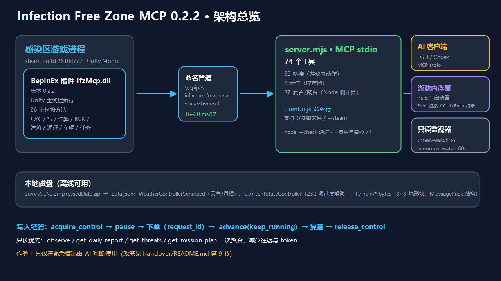
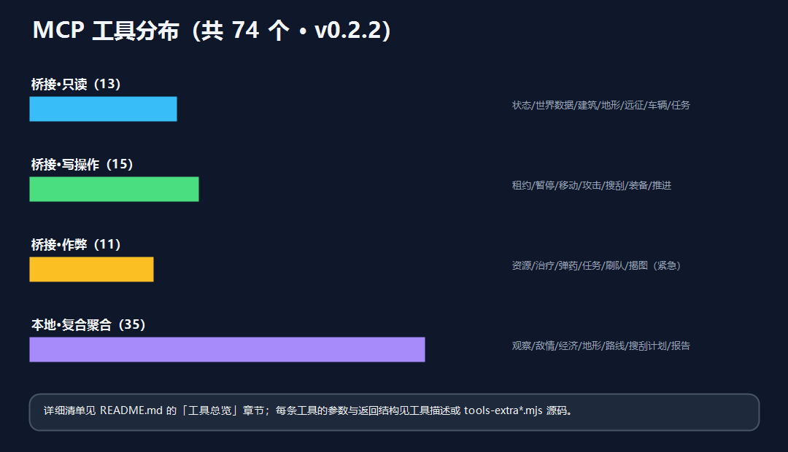
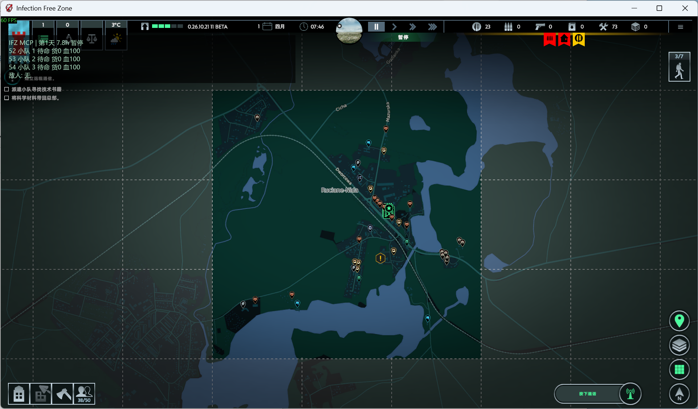
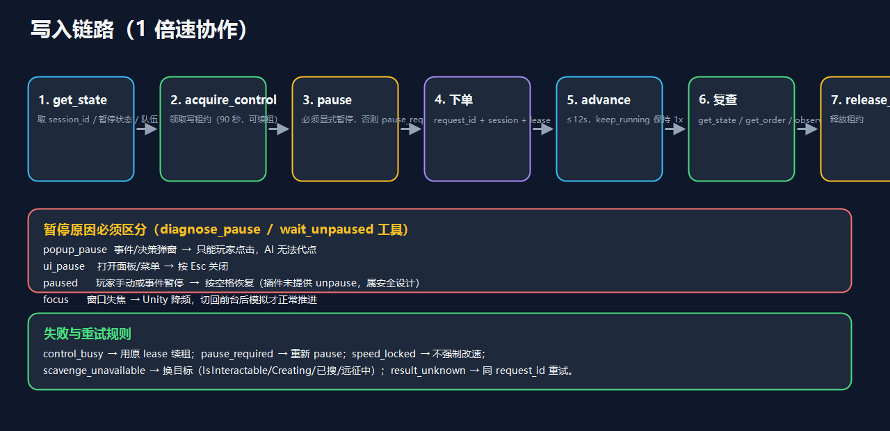

# 无感染区 MCP · v0.2.2

## 🌐 多语言文档 / Translations

| 语言 | 文档 |
|---|---|
| **简体中文（当前）** | [README.md](README.md) |
| **English** | [docs/i18n/README.en.md](docs/i18n/README.en.md) |
| **日本語** | [docs/i18n/README.ja.md](docs/i18n/README.ja.md) |
| **Русский** | [docs/i18n/README.ru.md](docs/i18n/README.ru.md) |

> 工具描述同样支持多语言：`node server.mjs --lang zh-CN|en|ja|ru`（或 `IFZ_MCP_LANG`），详见 [§2 多语言](#多语言mcp-工具描述)。

---

> 《Infection Free Zone》的人机协作 MCP 服务：BepInEx 插件在 Unity 主线程读写游戏，Node 侧用标准 MCP stdio 暴露 **92 个工具**，供 DSH / Codex 等 AI 客户端实时读取局势、下达订单，并与玩家 1 倍速同步协作。
>
> 适用 **Steam build 26104777**、Windows x64、Unity Mono。最后更新：2026-11-13。



---

## 目录

- **多语言文档 / Translations**：见页面顶部表格（[English](docs/i18n/README.en.md) · [日本語](docs/i18n/README.ja.md) · [Русский](docs/i18n/README.ru.md)）
- [运行截图](#运行截图)
- [1. 这是什么](#1-这是什么)
- [2. 快速开始](#2-快速开始)（含[多语言](#多语言mcp-工具描述)）
- [3. 构建、安装与升级（v0.2.2）](#3-构建安装与升级v022)
- [4. 工程结构](#4-工程结构)
- [5. 工具总览](#5-工具总览)
- [6. 复合工具详解](#6-复合工具详解)
- [7. 写入链路与人机协作](#7-写入链路与人机协作)
- [8. 作弊/调试工具与使用政策](#8-作弊调试工具与使用政策)
- [9. 游戏内聊天浮窗与多智能体监视](#9-游戏内聊天浮窗与多智能体监视)
- [10. 数据来源与离线能力](#10-数据来源与离线能力)
- [11. 常见问题（FAQ）](#11-常见问题faq)
- [12. 项目文档索引](#12-项目文档索引)
- [13. 变更登记](#13-变更登记)
- [14. 许可证 / License](#14-许可证--license)

---

## 1. 这是什么

| 层 | 组成 | 说明 |
|---|---|---|
| 游戏层 | 《无感染区》Steam build `26104777` | 存档位于 `%LOCALAPPDATA%Low\JutsuGames\Infection Free Zone\Saves` |
| 插件层 | `plugin/IfzMcp.csproj` → `IfzMcp.dll`（v0.2.2） | BepInEx 5 插件，Harmony 捕获游戏控制器 |
| 桥接层 | Windows 命名管道 `\\.\pipe\infection-free-zone-mcp-steam-v1` | 同用户 ACL，单次调用 16–20 ms，整轮 7 类读取约 115 ms |
| 服务层 | `server.mjs` | MCP stdio 服务，默认 92 个工具，DSH 平民协作配置 65 个，纯只读 59 个 |
| 客户端层 | DSH / Codex / `client.mjs` / 游戏内浮窗 / 只读监视器 | AI 通过 MCP 对话；玩家在游戏里用浮窗插话/打断 |

**核心设计**

- **只读优先**：绝大多数分析用复合工具一次聚合（`observe`、`get_daily_report`、`get_mission_plan`…），减少往返与 token。
- **写入受控**：常规游戏订单写入要求「写租约 + 显式暂停 + 请求 UUID」，未知结果可用同一 `request_id` 安全重试。
- **作弊兜底**：11 个 `cheat_*` 工具只在紧急情况由 AI 判断使用，默认走正常玩法。
- **离线可用**：天气、进度解锁、存档信息直接从 `data.json` 读取，不需要游戏在运行。



---

## 运行截图

聚落地图显示小队状态、任务目标、资源图标和地形，左上角显示插件的游戏内 HUD。



## 2. 快速开始

```powershell
# 0) 依赖（首次）
npm ci

# 1) 游戏已从 Steam 启动并进入聚落后，确认桥接
node client.mjs --steam status        # 期望 version=0.2.2, ready=true

# 2) 一次看全局势（推荐入口）
node client.mjs --steam observe '{}'

# 3) 查任务与行动计划
node client.mjs --steam get_missions '{}'
node client.mjs --steam get_mission_plan '{}'

# 4) 查敌情 / 资源图标 / 远征 / 车辆
node client.mjs --steam get_enemy_report '{}'
node client.mjs --steam find_buildings_by_poi '{"poi":["Gun","Fuel"]}'
node client.mjs --steam get_vehicle_map '{}'
node client.mjs --steam get_expedition_summary '{}'   # 先在游戏里打开世界地图

# 5) 工具清单自检（不需要游戏）
npm run tools:list
```

> `client.mjs` 支持两种参数形式：**直接 JSON** 或 **`@文件路径`**（UTF-8 JSON 文件，避免 PowerShell 5.1 引号/中文转义问题）。
> 连接隔离测试副本时去掉 `--steam`。

### 多语言（MCP 工具描述）

- `node server.mjs --lang zh-CN|en|ja|ru`，或设置环境变量 `IFZ_MCP_LANG`，可切换 MCP 工具描述语言（默认 `en`）。
- 翻译表在 [i18n.mjs](i18n.mjs)，缺失项自动回退英文；`stderr` 会打印 `[ifz-mcp] language=...` 便于确认。
- 文档翻译：[English](docs/i18n/README.en.md) · [日本語](docs/i18n/README.ja.md) · [Русский](docs/i18n/README.ru.md)（配英文版架构/流程图为 `docs/i18n/images/`）。

---

## 3. 构建、安装与升级（v0.2.2）

### 3.1 编译插件

```powershell
$gameRoot = 'C:\path\to\Infection Free Zone'
dotnet build plugin\IfzMcp.csproj -c Release `
  -p:IfzManaged="$gameRoot\Infection Free Zone_Data\Managed" `
  -p:BepInExCore="$gameRoot\BepInEx\core"
```

### 3.2 安装/升级到 Steam 版

```powershell
# 必须先退出游戏（DLL 被加载时会锁定）
$target = Join-Path $gameRoot 'BepInEx\plugins\IfzMcp.dll'
if (Test-Path -LiteralPath $target) {
    Copy-Item -LiteralPath $target -Destination "$target.bak-$(Get-Date -Format yyyyMMdd)"
}
Copy-Item plugin\bin\Release\netstandard2.1\IfzMcp.dll $target -Force
```

如需通过脚本安装 BepInEx，把 BepInEx 5.4.23.2 Windows x64 压缩包放到 `.local/tools/BepInEx_win_x64_5.4.23.2.zip`，然后运行：`scripts/Install-SteamPlugin.ps1 -GameRoot '<Steam 游戏安装目录>'`（会校验 `Ifz.dll` SHA256 并退出要求）。

### 3.3 升级后自检

```powershell
node client.mjs --steam status          # version 必须为 0.2.2
npm run tools:list                      # 默认 92 个工具
npm run tools:list -- --steam --workforce-only --allow-construction  # DSH 配置 65 个
```

### 3.4 v0.2.2 新增内容一览

| 批次 | 能力 | 工具 |
|---|---|---|
| 桥接 | 地形栅格（水/路/桥/高程） | `get_terrain_grid` |
| 桥接 | 建筑资源图标、搜刮进度、按图标搜索 | `get_building_info`、`get_scavenge_progress`、`find_buildings_by_poi` |
| 桥接 | 远征地块、全图车辆（含未发现） | `get_expedition_tiles`、`get_vehicle_map` |
| 桥接 | 任务详情/标记/目标进度 | `get_missions` |
| 桥接 | 作弊/调试 11 项 | `cheat_*` |
| 复合 | 地形报告、路线规划、搜刮目标/计划、日报、人口、武器、岗位、变更、找车 | 11 个 |
| 复合 | 敌人分析：总览/窝点/移动/战力/密度/变体/动物/中立 | 8 个 |
| 复合 | 进度解锁、暂停诊断、等待恢复 | 3 个 |
| 复合 | 资源热点、远征汇总、任务行动计划 | 3 个 |

---

## 4. 工程结构

```text
InfectionFreeZone-MCP/
├─ plugin/                      # C# 插件（BepInEx）
│  ├─ Plugin.cs                 # 入口、会话、租约、Dispatch、advance
│  ├─ PipeBridge.cs             # 命名管道与主线程队列
│  ├─ WorldData.cs              # get_world_data 各类目
│  ├─ MapQuery.cs               # get_map_buildings（全图/近邻/走廊）
│  ├─ UnitControl.cs            # 小队/NPC 订单、装备、导航点
│  ├─ VehicleLogistics.cs       # 车辆与回仓
│  ├─ Terrain.cs                # get_terrain_grid（A* 图采样）
│  ├─ BuildingInfo.cs           # 建筑详情/资源图标/搜刮进度/按图标搜索
│  ├─ Expedition.cs             # 远征地块、全图车辆
│  ├─ Missions.cs               # 任务详情、单任务完成
│  ├─ Cheats.cs                 # 11 个作弊/调试桥接
│  └─ Hud.cs                    # 游戏内 HUD 提示
├─ server.mjs                   # MCP 服务与工具注册
├─ tools-extra.mjs              # 复合工具第一批（观察/经济/威胁/天气…）
├─ tools-extra2.mjs             # 第二批（地形报告/路线/搜刮计划/日报/岗位…）
├─ tools-extra3.mjs             # 第三批（敌人/感染变体/动物/中立/进度/暂停）
├─ tools-extra4.mjs             # 第四批（资源热点/远征汇总/任务行动计划）
├─ weather.mjs                  # 存档天气/月相解析（离线）
├─ client.mjs / map-query.mjs   # 命令行客户端
├─ coop.mjs                     # 1 倍速协作命令（brief/scavenge/return/check）
├─ runtime/                     # 常驻运行时（状态缓存/事件/执行/DSH 唤醒）
├─ handover/                    # 交接文档 + PS 5.1 浮窗启动器
├─ docs/img/                    # 文档配图（本 README 引用）
├─ scripts/                     # 构建/安装/测试副本启动
├─ renew/                       # 变更登记（每次改动必须写入）
├─ .local/                      # 本地缓存、测试脚本、监视器、快照（不入库）
└─ *.md                         # 架构/地图/路线/经验/协作规则等文档
```

**测试与自检脚本**

| 脚本 | 作用 |
|---|---|
| `npm run tools:list` | MCP 握手并列出工具。可加 `-- --read-only` 检查纯只读配置 |
| `npm run tools:call` | 检查聚落、无线电、存档和态势，失败时退出码非零。可加 `-- --steam --read-only` 检查 Steam 连接 |
| `npm test` | 运行 Runtime 测试，无需启动游戏 |

---

## 5. 工具总览

### 平民派工与建筑

Codex 和 DSH 的示例配置使用 `--workforce-only --allow-construction`。AI 可以派工、建造和管理设施，玩家负责小队。`get_enemy_report` 和 `get_fog_of_war` 提供敌情与迷雾查询。

- `get_workforce` 列出可用人数、分配模式和任务。`update_work_task` 接收刚读到的 `expected_value`。手动模式设置 `assigned_workers`，优先级模式设置 `max_workers` 或 `priority`。
- `get_construction_catalog` 列出可建造类型、解锁和尺寸限制。`preview_construction` 核对整块地基的水面、坡度、相邻建筑和材料，并返回人员容量、施工与生产工时。
- `new` 可直接指定最终用途、中心 `x` 和 `z`、长宽高及外墙。完工时自动成为目标建筑。`adapt` 使用 `building_id` 改造现有建筑。取得写租约后通过 `queue_construction` 提交，再用同一 `request_id` 查询 `get_construction_order`。
- 指定位置可以说「总部中心向东 30 米、向北 20 米」。向东增加 `x`，向北增加 `z`。
- `get_facilities` 按生产、防御或医疗类型查询设施。`set_facility_production` 可安排配方切换，`set_facility_defense_weapon` 可更换城门和塔的武器。医院提供医生和床位查询，医生人数走派工工具。

### 5.1 桥接·只读

| 工具 | 说明 |
|---|---|
| `status` | 桥接版本、场景、会话、租约持有者 |
| `get_state` | 时间、暂停原因、总部、小队概览、advance 状态 |
| `get_current_weather` | 当前聚落的天气、气温（°C）、降水、风和月相 |
| `get_mood` | 居民情绪等级、趋势、起因以及对工人效率和出生率的影响 |
| `get_order` | 查询某次移动订单的结果 |
| `get_world_data` | 14 类对象分页读取（见 §5.5） |
| `get_map_buildings` | 建筑查询：全图/近邻/路线走廊，可只返回可搜刮 |
| `get_navigation_point` | 单点投影：地面坐标、高度、area、偏移 |
| `get_terrain_grid` | **地形栅格**：水/路/建筑/墙/桥候选/高程，一次调用（A* 图采样） |
| `get_building_info` | **建筑详情**：类型、状态、资源图标、搜刮进度、剩余物资 |
| `get_scavenge_progress` | **进行中的搜刮**：进度、剩余时间、剩余物资箱、内部人数 |
| `find_buildings_by_poi` | **按图标找建筑**：`["Gun","Fuel","Drugs"...]` |
| `get_expedition_tiles` | **远征地块**：类型/位置/资源图标/搜刮进度/已获资源 |
| `get_vehicle_map` | **全图车辆**（含未发现）：类型/状态/油量/货物/距离 |
| `get_missions` | **任务详情**：标题键/章节/限时/目标类型与进度/标记坐标 |
| `get_active_dialogue` | 无线电正文、可选项、后果提示和上次选择后的台词 |
| `get_squad_experience` | 队员的各项熟练度、已激活技能和当前武器实际射程 |
| `get_weapon_details` | 武器的基础射程、伤害、攻击间隔、弹药和使用限制 |
| `get_attack_conditions` | 指定小队对可见敌群的实时射程、视线、弹药、冷却和开火状态 |

### 5.2 桥接·写操作（17）

| 工具 | 说明 |
|---|---|
| `acquire_control` / `release_control` | 领取/续租/释放写租约（默认 90 秒） |
| `pause` | 显式暂停（常规订单写入前必需） |
| `advance` | 有界推进（1–12 墙钟秒，`keep_running` 保持 1x） |
| `hud_message` | 游戏内 HUD 短提示 |
| `move_squad` | 小队移动（6–100 单位/步，`replace_orders` 覆盖） |
| `cancel_squad_order` | 按原请求 ID 终止一个已跟踪的原生小队订单 |
| `move_npc_group` | 非玩家群组移动目标 |
| `attack_group` | 攻击可见敌对群 |
| `scavenge_building` | 派队搜刮建筑 |
| `return_to_stockroom` | 回仓卸货（步行/乘车语义不同） |
| `take_vehicle` | 占领废弃车辆 |
| `set_stockpile_amount` | 设置库存数量（先读 `expected_amount`） |
| `set_building_workers` | 调整工地岗位上限 |
| `equip_squad_member` | 从背包/库存装备武器 |
| `refill_squad_member_ammo` | 从容器补充弹药 |
| `choose_dialogue_option` | 通过游戏原生按钮提交当前无线电选项 |

### 5.3 桥接·作弊/调试（11，紧急使用）

| 工具 | 说明 |
|---|---|
| `cheat_list` | 列出作弊项 |
| `cheat_heal_squads` | 全员满血 |
| `cheat_refill_ammo` | 弹药补满 |
| `cheat_add_resources` | 直接向库存加资源 |
| `cheat_unlock_expedition` | 解锁全部远征地块 |
| `cheat_complete_missions` | 完成**全部**进行中任务 |
| `cheat_complete_mission` | 完成**单个**任务（更精细） |
| `cheat_scavenge_all` | 全图废弃建筑标记已搜刮 |
| `cheat_set_time` | 设置天数/小时/时间流速 |
| `cheat_spawn_squad` | 指定坐标刷小队 |
| `cheat_reveal_groups` | 显示全部敌对群（含隐藏） |

### 5.4 本地/复合（34 + 天气）

**基础聚合**

| 工具 | 说明 |
|---|---|
| `get_weather` | 天气/月相/38 天预报（读存档，**离线可用**） |
| `observe` | 一次拿全：时间/小队+载具/库存/缺口/敌情/天气 |
| `get_daily_report` | 日报：时间/天气/缺口/工地/威胁/任务 |
| `get_threats` | 敌情摘要（距离/方位/是否逼近，含隐藏群） |
| `get_economy` | 资源缺口 + 空置岗位 |
| `get_squads_report` | 小队名册（指令/血量/载货/油量） |
| `get_events_report` | 任务与事件精简列表 |
| `get_save_info` | 最新存档信息 + 天气（离线） |
| `get_map_info` | 城市/瓦片/边界 |
| `get_recommendations` | 启发式建议（回防/补资源/调岗/撤退） |
| `bridge_probe` | 桥接延迟测量 |
| `export_snapshot` | 导出世界快照到 `.local/snapshots/` |

**地形与路线**

| 工具 | 说明 |
|---|---|
| `get_terrain_report` | 水域/道路/建筑占比、桥梁坐标、高程、最通畅走廊 |
| `plan_route` | A* 步行路线（道路便宜、水/墙阻挡），返回距离/途经点/过桥格数 |

**搜刮与发展**

| 工具 | 说明 |
|---|---|
| `get_loot_targets` | 未搜刮建筑按距离排序 + 每队最近目标 + 300 m 聚类 |
| `get_scavenge_plan` | 贪心分配：每队独立建筑序列 |
| `get_colonists_report` | 人口/儿童/武装人数/伤员/岗位分布 |
| `get_weapons_report` | 武器类型表 + 各队武器构成 |
| `get_worker_balance` | 空置岗位 vs 岗位分布 + 配人建议 |
| `get_vehicle_hunt` | 车辆清单 + 最近小队 + 未占领车辆 |
| `get_changes` | 与上次调用差异（库存/血量/指令/威胁数；落盘缓存） |

**敌情与生物**

| 工具 | 说明 |
|---|---|
| `get_enemy_report` | 敌群总览：武器构成/火力评分/距离方位/逼近判断 |
| `get_enemy_lairs` | 窝点清单（感染者/感染犬窝点分类、威胁排序） |
| `get_enemy_moves` | 移动追踪（两次调用间位移，落盘缓存） |
| `get_combat_estimate` | 对可见敌群评估战力，并结合当前开火条件和补给给出建议 |
| `get_enemy_density` | 敌群密度 ASCII 热图 |
| `get_infected_types` | 感染者变体识别（普通/自爆/阿尔法/犬/鸟/尖啸/巨型/巨兽/强化） |
| `get_animal_report` | 感染动物 + 普通野生动物（物种/数量/敌对性） |
| `get_neutral_report` | 中立群/野生动物/移民（标注不可攻击） |

**进度、暂停与任务**

| 工具 | 说明 |
|---|---|
| `get_progression` | 存档 232 项内容解锁状态（建筑/生产/敌人生成/科技；**离线**） |
| `diagnose_pause` | 暂停原因诊断 + 恢复建议 |
| `wait_unpaused` | 轮询等待解除暂停（超时返回具体原因） |
| `get_resource_hotspots` | 按资源图标统计建筑数量与最近位置 |
| `get_expedition_summary` | 远征汇总：地块分布、资源图标总量、最富地块 |
| `get_mission_plan` | **任务行动计划**：按目标类型给可执行下一步 |

### 5.5 `get_world_data` 类目

| category | 数据 |
|---|---|
| `squads` | 小队、成员坐标/生命/武器/弹药/背包 |
| `citizens` / `workers` | 人口 / 工人、生命、年龄类别、当前工作 |
| `groups` / `virtual_groups` | 实体/虚拟非玩家群（**含隐藏**）、阵营、位置、可见性 |
| `map` | 城市、瓦片、世界边界 |
| `worksites` | 有工作的建筑、在岗/上限/原始上限 |
| `vehicles` | **已发现**或玩家拥有的车辆（含后备箱/油量） |
| `stockrooms` | 可用共享仓库/总部 |
| `stockpile` / `ground_resources` | 共享库存（实物+虚拟） / 地面资源 |
| `resource_types` | 可写入库存的资源 ID |
| `weapons` | 武器定义、弹药类型、弹匣容量 |
| `events` | 已触发事件、任务目标完成状态、标记坐标 |

---

## 6. 复合工具详解

### 6.1 一次看全（省 token 首选）

```powershell
node client.mjs --steam observe '{}'
# { time, headquarters, squads[], stockpile, shortfalls[], threats{count,closing,nearest[]}, weather }
```

### 6.2 任务全部真做（不跳过）

```powershell
node client.mjs --steam get_missions '{"include_types":true}'
node client.mjs --steam get_mission_plan '{}'
```

`get_mission_plan` 会按目标类型给出可执行动作：

| 目标类型 | 给出的动作 |
|---|---|
| `KillCharacters` / `DefeatInfected` / `ClearLair` | 最近敌对群/窝点 + 最近队伍 + 先 `get_combat_estimate` |
| `ScavengeResource` / `SendSquadToScavengeBuilding` | 最近可搜刮建筑（可直接 `scavenge_building`） |
| `CollectResource` / `ProduceResource` | 空置工地（可派工） |
| `AssignWorkers` | 空置岗位 + 可设置的岗位上限 |
| `HealGroup` | 低于 60 血的队伍 |
| `SendToMarker` / `SendToMarkers` | 任务标记坐标 + 最近队伍 |
| `AdaptBuilding` 类 | 提示"需玩家在游戏内选楼" |
| `SurviveNight` | 日落倒计时 |

### 6.3 资源图标（与游戏地图图标同规则）

```powershell
node client.mjs --steam find_buildings_by_poi '{"poi":["Gun","Fuel"]}'
node client.mjs --steam get_resource_hotspots '{"radius":2000}'
node client.mjs --steam get_building_info '{"building_id":"534237227"}'
```

图标枚举：`Research`、`Drugs`、`Tools`、`Food`、`Bakery`、`Barn`、`Fuel`、`Gun`、`Parking`、`Expedition`、`Warehouse`、`Sport`、`Museum`、`Metal`。
> 建筑内**具体物资清单**只有玩家小队首次进入后才生成（`ScavengeWork.ResourcesToFind`），进入前靠图标判断；进入后 `get_building_info` 可读剩余物资与进度。

### 6.4 地形与路线

```powershell
node client.mjs --steam get_terrain_report '{"step":75}'
node client.mjs --steam plan_route '{"from_x":1430,"from_z":1146,"to_x":1580,"to_z":960}'
```
- 地形采样自 A* recast 图（Tag：0 地面 / 2 水 / 4 墙 / 6·7 建筑 / 29·31 道路）
- 一次调用 42×42 网格约 26 KB，1.2 s 内返回（含 CLI 启动）

### 6.5 敌人与生物

```powershell
node client.mjs --steam get_enemy_report '{}'
node client.mjs --steam get_enemy_lairs '{}'
node client.mjs --steam get_infected_types '{}'
node client.mjs --steam get_combat_estimate '{"group_id":"<群ID>"}'
node client.mjs --steam get_enemy_density '{"step":250}'
```

感染者变体（来自 `ResourceID` / `InfectedTypes`）：

| 变体 | ID | tier | 战力权重 |
|---|---|---|---|
| 普通感染者 | `eq_inf_human` | 1 | 0.4 |
| 感染犬 / 鸟 | `eq_inf_dog` / `eq_inf_bird` | 1 | 0.35 / 0.5 |
| 低吼者 / 尖啸者 | `eq_inf_growler` / `eq_inf_screamer` | 2 | 0.7 / 0.8 |
| **自爆感染者** | `eq_inf_human_explosives` | 3 | 1.3 |
| 巨型感染者 | `eq_inf_huge` | 3 | 1.5 |
| **阿尔法感染者** | `eq_inf_alpha` | 4 | 1.6 |
| 感染熊/驼鹿/公牛 | `eq_inf_bear/moose/bull` | 3 | 1.4 |
| 巨兽（坦克级） | `inf_tank_bear/bull/moose` | 4 | 2.0 |
| 强化版 | `*_boosted` | +1 | +0.2~0.5 |

> 巨兽/自爆/阿尔法/感染鸟属于**后期进度解锁或未启用的生成项**（见 `get_progression` 的 `GroupSpawn_*` 状态）。

### 6.6 进度与暂停

```powershell
node client.mjs --steam get_progression '{"category":"enemy"}'
node client.mjs --steam diagnose_pause '{}'
node client.mjs --steam wait_unpaused '{"timeout_s":30}'
```
- `get_progression` 读存档 `ContentStateController`（232 项，当前档已解锁 72 项）
- 暂停四类：`popup_pause`（弹窗，需玩家点）/ `ui_pause`（面板，Esc）/ `paused`（空格）/ 失焦降频

---

无线电可选回复会产生 `dialogue_options_available` 事件。读取和选择流程见 [Runtime 无线电剧情选择](runtime/README.md#无线电剧情选择)。

### 6.7 小队经验和武器详情

- `get_squad_experience` 接受可选的 `squad_id`。每名存活队员返回射击、近战、搜刮和驾驶的当前经验与上限，以及已激活技能、当前使用的武器和 `effective_range`。射程使用游戏对该队员的实际计算，包含神枪手技能修正。
- `get_weapon_details` 接受可选的 `weapon_id`，例如 `eq_sniper_rifle`。武器目录给出聚落与远征基础射程、近距阈值、武器提示中的近远伤害、射击间隔、弹药、弹匣和使用条件。
- 两个工具都使用 `get_state` 返回的 `session_id`，可在原生 MCP 的 `--read-only` 模式下调用。射程以游戏世界单位计。

### 6.8 开火条件和紧急中止

- `get_attack_conditions` 接受 `session_id`、`squad_id` 和 `group_id`。每名队员以最近的敌方成员为目标，返回有效射程、视线、剩余弹药、冷却以及当前站位能否开火。虚拟敌群传 `virtual: true`，返回虚拟战斗模式。
- `get_combat_estimate` 汇总所选小队的开火人数，优先提示低血、缺弹、暂停、站位或冷却问题。
- 协作模式用 Runtime 的 `action_force_stop` 按任务 ID 终止订单并显示原因。原生写模式可用 `cancel_squad_order`，`order_id` 传原订单的 `request_id`，另生成一个取消请求 ID。两者都按订单实例取消。

## 7. 写入链路与人机协作



标准写入流程（详见 [runtime/README.md](runtime/README.md) 与 [AI游戏协作规则.md](AI游戏协作规则.md)）：

```text
get_state → acquire_control → pause → 下单(request_id) → advance(keep_running) → 复查 → release_control
```

### 7.1 一次移动示例

```powershell
node client.mjs --steam get_state
# 记下 session_id / 空闲小队
node client.mjs --steam acquire_control '{"owner":"dsh-lead","ttl_seconds":180}'
# 记下 lease
node client.mjs --steam pause '{"lease":"<lease>","session_id":"<sid>"}'
node client.mjs --steam get_navigation_point '{"session_id":"<sid>","x":1500,"z":1600,"y":25}'
node client.mjs --steam move_squad '{"lease":"<lease>","session_id":"<sid>","request_id":"<uuid>","squad_id":"53","x":1500,"z":1600}'
node client.mjs --steam advance '{"lease":"<lease>","session_id":"<sid>","seconds":8,"keep_running":true,"allow_background":true}'
node client.mjs --steam release_control '{"lease":"<lease>"}'
```

### 7.2 1 倍速协作命令（`coop.mjs`）

```powershell
node client.mjs --steam coop brief --near 835
node client.mjs --steam coop scavenge --session <sid> --player 834 --squad 835 --building 417900143 --notice "去总部东南约200米的楼搜刮"
node client.mjs --steam coop return  --session <sid> --squad 835
node client.mjs --steam coop check   --session <sid> --squad 835
```

### 7.3 错误码速查

| 错误码 | 处理 |
|---|---|
| `bridge_offline` | 启动游戏（Steam 版或测试副本） |
| `not_ready` / `stale_session` | 载入聚落后重新 `get_state` |
| `lease_required` | 先 `acquire_control`；持有时传入原 lease 续租 |
| `control_busy` | 其他客户端持租约；用原 lease 续租或等待 |
| `pause_required` | 重新 `pause`（玩家操作会让游戏解除暂停） |
| `speed_locked` | 玩家锁定速度，不要强制改速 |
| `scavenge_unavailable` | 目标不可搜/已搜/远征中/不可达（`CanGoToStructure`） |
| `squad_unavailable` | 小队忙/在车上；显式 `replace_orders` 或换队 |
| `result_unknown` | 用**同一 request_id** 重试 |
| `order_not_found` | 移动回执不存在或已超出最近记录，重新读取小队实际状态 |

---

## 8. 作弊/调试工具与使用政策

启动原生 MCP 时可加 `--enable-cheats`，通过 `cheat_catalog` 查询分类和参数，通过 `cheat_apply` 执行单项操作。纯只读模式可查询目录。

- 11 个 `cheat_*` 全部要求写租约，走游戏原生 `GameConsoleCommandHandler` 与容器接口。
- **仅限紧急**：关键小队即将全灭、存档卡死、任务无法完成、玩家明确要求；先用非作弊手段。
- 执行顺序：只读诊断 → 最小干扰命令 → **立刻复查数据**（`observe`/`get_threats`/`get_state`）→ 记录到 `.local/runs/`。
- 详细政策见 [handover/README.md](handover/README.md) 第 9 节。

```powershell
node client.mjs --steam cheat_list '{"lease":"<lease>","session_id":"<sid>"}'
node client.mjs --steam cheat_heal_squads '{"lease":"<lease>","session_id":"<sid>"}'
node client.mjs --steam cheat_add_resources '{"lease":"<lease>","session_id":"<sid>","resource_id":"res_metal","quantity":20}'
```

---

## 9. 游戏内聊天浮窗与多智能体监视

- 浮窗：`handover/Start-ChatWindow-ps5.ps1`（PowerShell 5.1 兼容），回车插话、Ctrl+回车打断；需要 runtime 在 8790 端口运行。
- 启动方式、恢复清单、故障排查见 [handover/README.md](handover/README.md)。
- 可用 Runtime 的 `/state` 和 `/events` 实现本地只读监视，协作模式由单个执行方持有游戏写租约。

---

## 10. 数据来源与离线能力

| 数据 | 来源 | 是否需要游戏运行 |
|---|---|---|
| 实时状态/订单/单位 | 命名管道 → 插件（Unity 主线程） | 是 |
| 实时天气、气温、居民情绪 | 游戏 `WeatherController`、`MoodController` | 是 |
| 天气、月相、38 天预报 | 存档 `data.json` → `WeatherControllerSerialized` | **否** |
| 进度解锁（232 项） | 存档 `ContentStateController._contentStatesList` | **否** |
| 存档信息（天数/城市/时间） | 存档 `info.json` | **否** |
| 地形原始块 | 存档 `Terrain/*.bytes`（3×3，MessagePack 结构，约 300 KB/块） | **否**（解析器待做；当前用插件在线栅格） |

---

## 11. 常见问题（FAQ）

**Q1：`vehicles` 类目为空？**
`get_world_data(vehicles)` 只返回已发现或玩家拥有的车。用 `get_vehicle_map` 看全图（含未发现的废弃车）。

**Q2：建筑里有什么查不到？**
物资列表在小队首次进入废墟时才生成。进入前用 `find_buildings_by_poi` / `get_building_info` 的 `poi_icons` 判断；进入后用 `get_building_info` / `get_scavenge_progress` 读剩余物资与进度。

**Q3：远征查不到？**
`get_expedition_tiles` 需要先在游戏里打开世界地图（远征界面）让瓦片加载，否则返回 `expedition_not_ready`。

**Q4：任务能直接跳过吗？**
可以（`cheat_complete_mission(s)`），但默认**不用**——按 `get_mission_plan` 逐步真做；作弊仅紧急。

**Q5：搜索/搜刮经常 `scavenge_unavailable`？**
插件校验四条件（远征中/不可搜/已搜过/`CanGoToStructure`），其中 `Draft.IsInteractable`、`Creating`、`Deconstructing`、hideout 权限都会拒绝；换目标或先 `get_building_info` 看状态。

**Q6：游戏一直暂停？**
先 `diagnose_pause`：弹窗需玩家点击；面板按 Esc；手动暂停按空格；失焦切回前台。

**Q7：桥接离线怎么办？**
本地工具仍可用：`get_weather`、`get_save_info`、`get_progression`、`export_snapshot`（部分）、`bridge_probe` 除外。

**Q8：`deflate`/`MessagePack` 地形解析做到哪了？**
已确认 `Terrain/*.bytes` 是 MessagePack（`0x83 "version"/"1"/"data"` 头），解析器尚未完成；当前优先用插件 `get_terrain_grid`（更快且含道路/水面语义）。


---

## 12. 项目文档索引

| 文档 | 内容 |
|---|---|
| [架构分析-三大基础能力.md](架构分析-三大基础能力.md) | 实时状态/持续交流/异步执行系统设计；DSH 驱动/流式/中断；数据体量排名与查询策略 |
| [地图数据量分析.md](地图数据量分析.md) | 地图类目实测：金华 6749 栋≈1.58 MB/68 页；Ruciane 378 栋≈164 KB |
| [地图数据优化方案.md](地图数据优化方案.md) | P0 纯 Node → P1 插件过滤 → P2 推送订阅的渐进优化 |
| [地图分块读取方案.md](地图分块读取方案.md) / [地图分块分配策略.md](地图分块分配策略.md) / [地图分块数量与障碍物分析.md](地图分块数量与障碍物分析.md) | 按网格分块读取、坐标→块定位、覆盖块数、A* 障碍信息 |
| [地图分层结构分析.md](地图分层结构分析.md) | 聚落地图与远征地图的分层/分块策略 |
| [路线分析.md](路线分析.md) | 游戏类、字段与原生修改入口（本机反编译记录） |
| [AI游戏协作规则.md](AI游戏协作规则.md) | 人机分工、车辆补给、敌情优先级、同步操作约定 |
| [经验-无感染区AI协作.md](经验-无感染区AI协作.md) | 实战经验手册 + 问题分析（工具边界、搜刮/战斗/天气坑位、沟通协议、实测数据） |
| [handover/README.md](handover/README.md) | 交接：游戏内浮窗 + 多智能体监视 + 恢复清单 + 故障排查 + 作弊政策 |
| [runtime/README.md](runtime/README.md) | 常驻运行时：状态缓存、事件、执行队列、DSH 唤醒 |
| [renew/README.md](renew/README.md) / [renew/0.1.txt](renew/0.1.txt) | 变更登记规范与全部修改记录 |
| [docs/img/](docs/img) | 文档配图：architecture / workflow / toolmap |
| [docs/i18n/README.en.md](docs/i18n/README.en.md) | **English** README（英文版文档，含英文架构/流程图为 `docs/i18n/images/`） |
| [docs/i18n/README.ja.md](docs/i18n/README.ja.md) | **日本語** README（日文版文档） |
| [docs/i18n/README.ru.md](docs/i18n/README.ru.md) | **Русский** README（俄文版文档） |
| [docs/i18n/](docs/i18n) | 多语言文档目录（English / 日本語 / Русский + 英文配图） |
| [LICENSE](LICENSE) | **许可证全文**：PolyForm Noncommercial 1.0.0（允许非商业使用/修改/再分发，禁止商用） |
| [THIRD_PARTY_NOTICES.md](THIRD_PARTY_NOTICES.md) | 第三方依赖许可证与游戏知识产权说明（本仓库不分发游戏文件） |

---

## 13. 变更登记

每次更新必须写入 [renew/README.md](renew/README.md) 与 [renew/0.1.txt](renew/0.1.txt)。

- **v0.2.2（2026-11-12）**：插件版本 0.2.2；工具 74 个（+地形栅格、建筑图标、远征、车辆、任务、11 个作弊、任务行动计划等）；新增文档配图与详细 README。
- **v0.2.0（2026-11-11）**：作弊/地形批次；工具 32→43。
- **v0.1（2026-11-10）**：桥接、只读查询、移动/搜刮/攻击/装备、天气、运行时与协作层。

---

## 14. 许可证 / License

本项目采用 **[PolyForm Noncommercial 1.0.0](LICENSE)**：

| 允许 | 不允许 |
|---|---|
| ✅ 下载、阅读、学习 | ❌ 任何商业用途（付费分发、商业服务、企业内部商业运营等） |
| ✅ 修改、二次开发 | ❌ 移除版权/许可声明后分发 |
| ✅ 非商业再分发（需附带 [LICENSE](LICENSE) 与 Required Notice） | ❌ 分发游戏本体/游戏资源/`Ifz.dll` |

- 许可全文：[LICENSE](LICENSE)（含 `Required Notice: Copyright (c) 2026 tianq021 and InfectionFreeZoneMcp contributors`）。
- 第三方依赖（MCP SDK / zod / ws / BepInEx / Harmony / A* / Odin / Zenject 等）各自保留原许可证；游戏本体与资源 © JutsuGames，**本仓库不分发游戏文件**。详见 [THIRD_PARTY_NOTICES.md](THIRD_PARTY_NOTICES.md)。
- 需要商业授权时请通过仓库 Issue 联系作者。
- 说明：PolyForm Noncommercial 属于"源码可见 + 非商业"许可，并非 OSI 认证的开源许可；如需 OSI 开源许可（如 MIT/Apache-2.0）可另议。
