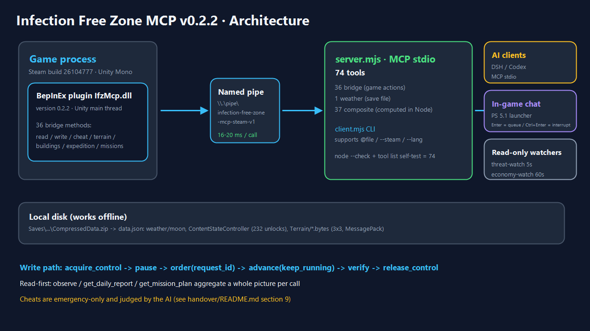
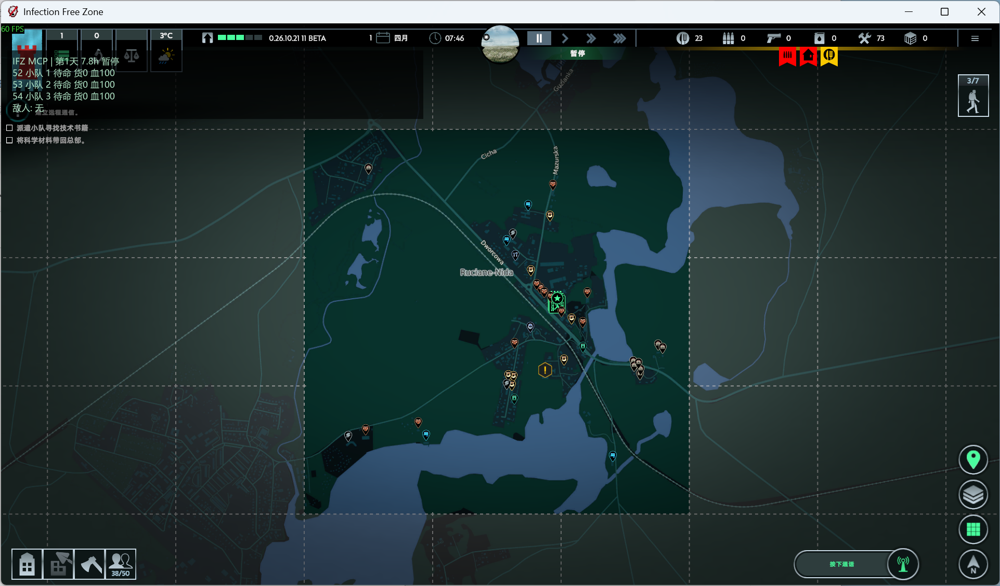
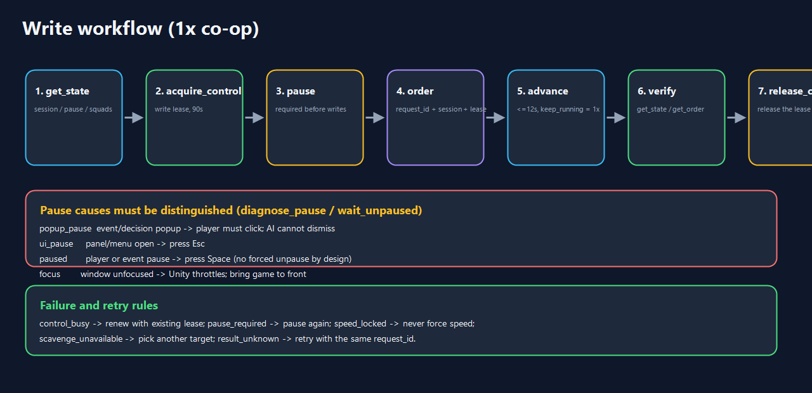

# Infection Free Zone MCP · v0.2.2 (English)

> A human–AI co-op MCP bridge for **Infection Free Zone** (Steam build `26104777`, Windows x64, Unity Mono).
> A BepInEx plugin reads/writes the game on the Unity main thread; a Node.js server exposes **76 MCP tools** over stdio so DSH / Codex and other AI clients can observe the settlement, issue native orders and play in 1× sync with the human player.

**Languages:** [简体中文](../../README.md) · **English** · [日本語](README.ja.md) · [Русский](README.ru.md)






---

## 1. What is included

| Layer | Component | Notes |
|---|---|---|
| Game | Infection Free Zone (Steam `26104777`) | Saves in `%LOCALAPPDATA%Low\JutsuGames\Infection Free Zone\Saves` |
| Plugin | `plugin/` → `IfzMcp.dll` v0.2.2 | BepInEx 5 plugin, Harmony hooks, **41 bridge methods** |
| Bridge | Named pipe `\\.\pipe\infection-free-zone-mcp-steam-v1` | ~16–20 ms per call |
| Server | `server.mjs` | **76 MCP tools** (41 bridge + 1 weather + 34 composite) |
| Clients | DSH / Codex / `client.mjs` / in-game chat window / read-only watchers | AI plays alongside the human |

**Design principles**

- **Read-first:** composite tools (`observe`, `get_daily_report`, `get_mission_plan`) aggregate a full picture in one call.
- **Controlled writes:** write lease + explicit pause + request UUID; unknown results are retried with the same `request_id`.
- **Cheats are emergency-only:** 11 `cheat_*` tools, gated by AI judgement and documented policy.
- **Works offline:** weather, progression unlocks and save metadata are parsed from `data.json`.

---

## 2. Quick start

```powershell
npm ci
node client.mjs --steam status            # expect version=0.2.2, ready=true
node client.mjs --steam observe '{}'      # full snapshot: time/squads/stock/threats/weather
node client.mjs --steam get_missions '{}'
node client.mjs --steam get_mission_plan '{}'
node client.mjs --steam get_enemy_report '{}'
node client.mjs --steam find_buildings_by_poi '{"poi":["Gun","Fuel"]}'
node client.mjs --steam get_vehicle_map '{}'
npm run tools:list                         # 76 tools, no game required
```

`client.mjs` accepts inline JSON or `@path/to/args.json` (recommended under PowerShell 5.1).
Use `--lang zh-CN | ja | ru` (or `IFZ_MCP_LANG`) to localize MCP tool descriptions.

---

## 3. Tool catalog (76)

`get_active_dialogue` reads the visible radio conversation, choices and in-game effect hints. `choose_dialogue_option` submits a current reply. For observed follow-up lines and Runtime setup, see the [radio dialogue guide](../../runtime/README.md#无线电剧情选择).

### 3.1 Bridge · read-only (13)

| Tool | Purpose |
|---|---|
| `status` | bridge/version/scene/session/lease |
| `get_state` | time, pause reasons, HQ, squads, advance |
| `get_order` | movement order result |
| `get_world_data` | 14 paged categories (squads/citizens/groups/vehicles/stockpile/worksites/events/map/weapons…) |
| `get_map_buildings` | buildings: full map / nearby circle / route corridor |
| `get_navigation_point` | project a point onto walkable ground |
| `get_terrain_grid` | **terrain grid**: water/road/wall/building/bridge/elevation via A* graph |
| `get_building_info` | **building detail**: type/state/resource icons/scavenge progress/remaining loot |
| `get_scavenge_progress` | all in-progress scavenges with progress and remaining crates |
| `find_buildings_by_poi` | **search buildings by map resource icon** (Gun/Fuel/Drugs/Tools/Metal/Warehouse…) |
| `get_expedition_tiles` | **expedition tiles**: area/location type, resource icons, scavenge state, progress |
| `get_vehicle_map` | **all vehicles incl. undiscovered wrecks** |
| `get_missions` | **mission detail**: title key, chapter, time limit, objective types/progress, markers |

### 3.2 Bridge · write (15)

`acquire_control`, `release_control`, `pause`, `advance`, `hud_message`, `move_squad`, `move_npc_group`, `attack_group`, `scavenge_building`, `return_to_stockroom`, `take_vehicle`, `set_stockpile_amount`, `set_building_workers`, `equip_squad_member`, `refill_squad_member_ammo`.

### 3.3 Bridge · cheat/debug (11, emergency only)

`cheat_list`, `cheat_heal_squads`, `cheat_refill_ammo`, `cheat_add_resources`, `cheat_unlock_expedition`, `cheat_complete_missions`, `cheat_complete_mission`, `cheat_scavenge_all`, `cheat_set_time`, `cheat_spawn_squad`, `cheat_reveal_groups`.

### 3.4 Local / composite (38)

**Situation:** `get_weather`, `observe`, `get_daily_report`, `get_threats`, `get_economy`, `get_squads_report`, `get_events_report`, `get_save_info`, `get_map_info`, `get_recommendations`, `bridge_probe`, `export_snapshot`
**Terrain:** `get_terrain_report`, `plan_route`
**Loot & development:** `get_loot_targets`, `get_scavenge_plan`, `get_colonists_report`, `get_weapons_report`, `get_worker_balance`, `get_vehicle_hunt`, `get_changes`
**Enemies & creatures:** `get_enemy_report`, `get_enemy_lairs`, `get_enemy_moves`, `get_combat_estimate`, `get_enemy_density`, `get_infected_types`, `get_animal_report`, `get_neutral_report`
**Progress / pause / missions:** `get_progression`, `diagnose_pause`, `wait_unpaused`, `get_resource_hotspots`, `get_expedition_summary`, `get_mission_plan`

---

## 4. Write workflow (1× co-op)

```text
get_state → acquire_control → pause → order(request_id) → advance(keep_running) → verify → release_control
```



Pause causes and handling:

| Flag | Cause | How to resume |
|---|---|---|
| `popup_pause` | event/decision popup | **player must click** (AI cannot dismiss) |
| `ui_pause` | panel/menu open | press Esc |
| `paused` | player or event pause | press Space (no forced unpause by design) |
| focus lost | window unfocused | bring game to foreground |

Common error codes: `lease_required`, `control_busy`, `pause_required`, `speed_locked`, `scavenge_unavailable`, `result_unknown` (retry with the same `request_id`).

---

## 5. Cheat policy (summary)

- Emergency only: squad about to be wiped, save stuck, mission impossible, explicit player request.
- Try normal actions first; apply the smallest intervention; verify data immediately afterwards; log to `.local/runs/`.
- Full policy: [handover/README.md](../../handover/README.md) (§9).

---

## 6. Repository layout

```text
plugin/            C# BepInEx plugin (41 bridge methods)
server.mjs         MCP server (76 tools)
tools-extra*.mjs   composite tools (1–4 batches)
weather.mjs        offline save weather parser
client.mjs         CLI client (--steam, @args.json)
runtime/           long-running state/event/exec/DSH runtime
handover/          chat window launcher (PS 5.1) + agent handoff docs
docs/img/          diagrams used by READMEs
docs/i18n/         this English / Japanese / Russian README set
renew/             mandatory change log
```

---

## 7. Documentation

| Document | Content |
|---|---|
| [README.md](../../README.md) | full Chinese README (most detailed) |
| [架构分析-三大基础能力.md](../../架构分析-三大基础能力.md) | realtime state / chat / async execution design |
| [地图数据量分析.md](../../地图数据量分析.md) | measured payload sizes (6749 buildings ≈ 1.58 MB on the large map) |
| [经验-无感染区AI协作.md](../../经验-无感染区AI协作.md) | field-tested playbook: tool limits, scavenging/combat/weather pitfalls |
| [handover/README.md](../../handover/README.md) | in-game chat window + multi-agent monitors + recovery checklist |
| [runtime/README.md](../../runtime/README.md) | runtime services |
| [renew/README.md](../../renew/README.md) | change log rules and history |

---

> This is a condensed translation. The Chinese [README.md](../../README.md) contains the complete catalog, FAQs and generated diagrams.

---

## 7. License

This project is licensed under **PolyForm Noncommercial 1.0.0** (see [LICENSE](../../LICENSE)): you may download, modify and redistribute it **for noncommercial purposes only** (keep the license and required notice). Commercial use requires prior written permission. Third-party dependencies keep their own licenses; game files are not distributed. See [THIRD_PARTY_NOTICES.md](../../THIRD_PARTY_NOTICES.md).
