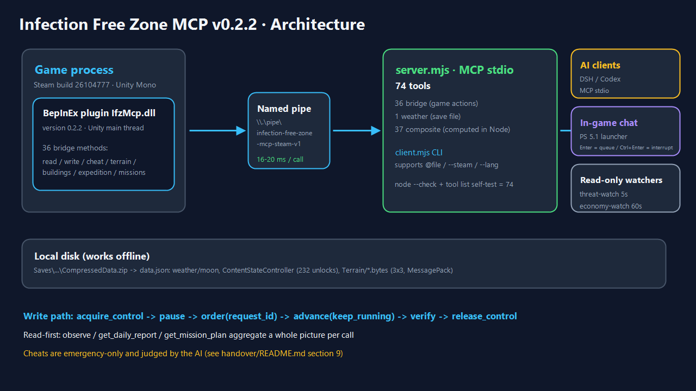
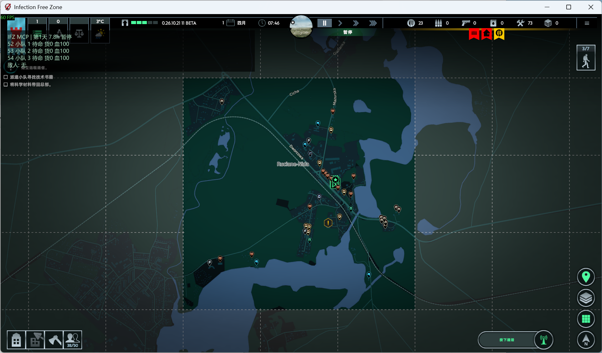
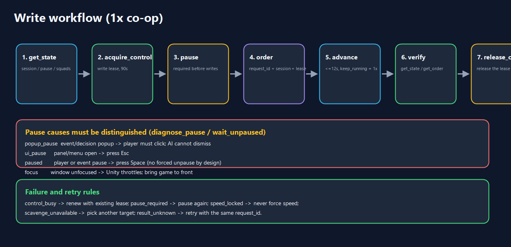

# Infection Free Zone MCP · v0.2.2（日本語）

> 『Infection Free Zone』（Steam build `26104777`、Windows x64、Unity Mono）向けの人間×AI 協調 MCP ブリッジです。
> BepInEx プラグインが Unity メインスレッドでゲームを読み書きし、Node.js サーバーが標準で **92 個の MCP ツール**を stdio で公開します。DSH / Codex などの AI クライアントは、拠点の状況を読み、ネイティブ命令を出し、プレイヤーと 1 倍速で協調プレイできます。

**言語：** [简体中文](../../README.md) · [English](README.en.md) · **日本語** · [Русский](README.ru.md)






---

## 1. 構成

| 層 | 構成 | 説明 |
|---|---|---|
| ゲーム | Infection Free Zone（Steam `26104777`） | セーブ: `%LOCALAPPDATA%Low\JutsuGames\Infection Free Zone\Saves` |
| プラグイン | `plugin/` → `IfzMcp.dll` v0.2.2 | BepInEx 5 + Harmony、**45 個のブリッジメソッド** |
| ブリッジ | 名前付きパイプ `\\.\pipe\infection-free-zone-mcp-steam-v1` | 1 回 16–20 ms |
| サーバー | `server.mjs` | 標準 92 ツール、読み取り専用 59 ツール、DSH の住民管理設定 65 ツール |
| クライアント | DSH / Codex / `client.mjs` / ゲーム内チャット窓 / 読み取り専用監視 | AI が人間と一緒にプレイ |

**設計方針**

- **読み取り優先**：`observe` / `get_daily_report` / `get_mission_plan` などで 1 回の呼び出しに集約。
- **書き込みは厳格に**：書き込みリース + 明示的な一時停止 + リクエスト UUID。不明な結果は同じ `request_id` で再試行。
- **チートは緊急時のみ**：11 個の `cheat_*`。AI の判断とポリシーに従う。
- **オフライン可**：天気・進行度・セーブ情報は `data.json` から直接読む。

---

## 2. クイックスタート

```powershell
npm ci
node client.mjs --steam status            # version=0.2.2, ready=true を確認
node client.mjs --steam observe '{}'      # 全体状況を 1 回で取得
node client.mjs --steam get_missions '{}'
node client.mjs --steam get_mission_plan '{}'
node client.mjs --steam get_enemy_report '{}'
node client.mjs --steam find_buildings_by_poi '{"poi":["Gun","Fuel"]}'
node client.mjs --steam get_vehicle_map '{}'
npm run tools:list                         # 標準 92 ツール（ゲーム不要）
```

`client.mjs` はインライン JSON か `@args.json`（PowerShell 5.1 では推奨）を受け付けます。
`--lang zh-CN | en | ja | ru`（または環境変数 `IFZ_MCP_LANG`）で MCP ツール説明を多言語化できます。

---

## 3. 主なツール

`get_active_dialogue` で無線の本文、選択肢、ゲーム内の効果ヒントを確認し、`choose_dialogue_option` で返答を選べます。選択後の台詞と設定は [Runtime の無線ガイド](../../runtime/README.md#无线电剧情选择)を参照してください。

`get_squad_experience` は隊員ごとの熟練度、有効なスキル、現在の武器の実射程を読み取ります。`get_weapon_details` は武器の基礎射程、ダメージ、攻撃間隔、使用条件を返します。

`get_attack_conditions` は、可視の敵群に対する距離、射線、弾薬、攻撃間隔を隊員ごとに確認します。協力プレイでは Runtime の `action_force_stop` で AI の命令を中止し、プレイヤーに理由を通知できます。直接操作モードでは `cancel_squad_order` を使います。

### 3.1 読み取り（13）
`status`、`get_state`、`get_order`、`get_world_data`（14 カテゴリ）、`get_map_buildings`、
`get_navigation_point`、**`get_terrain_grid`**（水/道路/壁/建物/橋/標高）、
**`get_building_info`**（資源アイコン/搜刮進捗/残り物資）、**`get_scavenge_progress`**、
**`find_buildings_by_poi`**（アイコンで建物検索）、**`get_expedition_tiles`**、
**`get_vehicle_map`**（未発見車含む）、**`get_missions`**（目標進捗/マーカー）

### 3.2 書き込み（15）
`acquire_control` / `release_control` / `pause` / `advance` / `hud_message` /
`move_squad` / `move_npc_group` / `attack_group` / `scavenge_building` /
`return_to_stockroom` / `take_vehicle` / `set_stockpile_amount` /
`set_building_workers` / `equip_squad_member` / `refill_squad_member_ammo`

### 3.3 チート/デバッグ（11、緊急時のみ）
`cheat_list` / `cheat_heal_squads` / `cheat_refill_ammo` / `cheat_add_resources` /
`cheat_unlock_expedition` / `cheat_complete_missions` / `cheat_complete_mission` /
`cheat_scavenge_all` / `cheat_set_time` / `cheat_spawn_squad` / `cheat_reveal_groups`

### 3.4 複合/ローカル（38）
状況：`get_weather`、`observe`、`get_daily_report`、`get_threats`、`get_economy`、
`get_squads_report`、`get_events_report`、`get_save_info`、`get_map_info`、
`get_recommendations`、`bridge_probe`、`export_snapshot`
地形：`get_terrain_report`、`plan_route`
搜刮/発展：`get_loot_targets`、`get_scavenge_plan`、`get_colonists_report`、
`get_weapons_report`、`get_worker_balance`、`get_vehicle_hunt`、`get_changes`
敵/生物：`get_enemy_report`、`get_enemy_lairs`、`get_enemy_moves`、`get_combat_estimate`、
`get_enemy_density`、`get_infected_types`、`get_animal_report`、`get_neutral_report`
進行/停止/任務：`get_progression`、`diagnose_pause`、`wait_unpaused`、
`get_resource_hotspots`、`get_expedition_summary`、`get_mission_plan`

---

## 4. 書き込みフロー（1 倍速協調）

```text
get_state → acquire_control → pause → 注文(request_id) → advance(keep_running) → 再確認 → release_control
```



| 停止要因 | 対処 |
|---|---|
| `popup_pause`（イベント/決定ポップアップ） | **プレイヤーがクリック**（AI は代行不可） |
| `ui_pause`（パネル/メニュー） | Esc で閉じる |
| `paused`（手動/イベント） | Space で再開（強制解除 API は意図的に未提供） |
| フォーカス喪失 | ゲームを前面に戻す（Unity が降頻） |

よくあるエラー：`lease_required`、`control_busy`、`pause_required`、`speed_locked`、
`scavenge_unavailable`、`result_unknown`（同じ `request_id` で再試行）。

---

## 5. チートポリシー（要約）

- 緊急時のみ：分隊壊滅寸前、セーブ進行不能、任務達成不能、プレイヤーの明示要求。
- まず通常操作を試す → 最小の介入 → 直後にデータを再確認 → `.local/runs/` に記録。
- 詳細：[handover/README.md](../../handover/README.md) §9。

---

## 6. リポジトリ構成

```text
plugin/            C# BepInEx プラグイン（45 ブリッジ）
server.mjs         MCP サーバーとツール登録
tools-extra*.mjs   複合ツール（4 バッチ）
weather.mjs        セーブ天気パーサ（オフライン）
client.mjs         CLI クライアント（--steam / --lang / @args.json）
runtime/           常駐ランタイム（状態/イベント/実行/DSH 連携）
handover/          チャット窓ランチャー（PS 5.1）+ エージェント引き継ぎ
docs/img/          中国語 README 用図
docs/i18n/         英語・日本語・ロシア語 README
renew/             変更履歴（必須）
```

---

## 7. ドキュメント

| 文書 | 内容 |
|---|---|
| [README.md](../../README.md) | 中国語の完全版 README（最も詳細） |
| [経験-無感染区AI協作.md](../../经验-无感染区AI协作.md) | 実戦ノウハウ（ツール限界・搜刮/戦闘/天気の落とし穴） |
| [handover/README.md](../../handover/README.md) | ゲーム内チャット窓 + 監視エージェント + 復旧手順 |
| [runtime/README.md](../../runtime/README.md) | 常駐ランタイム |
| [renew/README.md](../../renew/README.md) | 変更履歴ルール |

> 本書は要約版です。完全なツールカタログ・FAQ は中国語 [README.md](../../README.md) を参照してください。

---

## 7. ライセンス

本プロジェクトは **PolyForm Noncommercial 1.0.0**（[LICENSE](../../LICENSE)）で提供されます。ダウンロード・改変・**非商用**での再配布は可能（ライセンスと Required Notice の保持が必要）。商用利用は事前の書面許可が必要です。ゲーム本体/ファイルは同梱しません。詳細は [THIRD_PARTY_NOTICES.md](../../THIRD_PARTY_NOTICES.md)。
