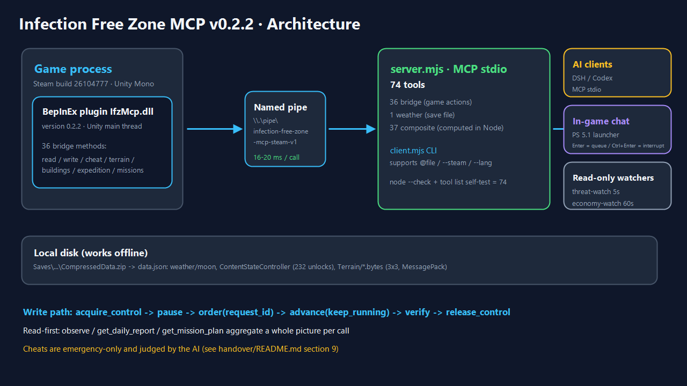
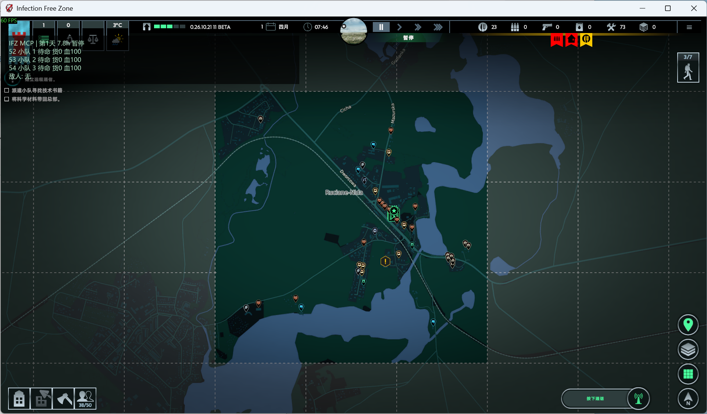
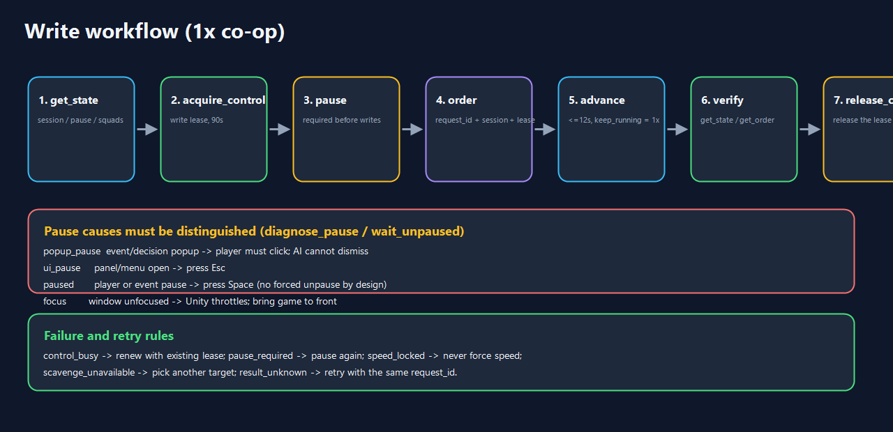

# Infection Free Zone MCP · v0.2.2 (Русский)

> MCP-мост для совместной игры человека и ИИ в **Infection Free Zone** (Steam build `26104777`, Windows x64, Unity Mono).
> Плагин BepInEx читает и изменяет игру в главном потоке Unity, а сервер Node.js публикует **80 MCP-инструмента** через stdio: DSH / Codex и другие ИИ-клиенты видят поселение, отдают нативные приказы и играют в 1× синхронизации с игроком.

**Языки:** [简体中文](../../README.md) · [English](README.en.md) · [日本語](README.ja.md) · **Русский**






---

## 1. Состав

| Уровень | Компонент | Описание |
|---|---|---|
| Игра | Infection Free Zone (Steam `26104777`) | Сохранения: `%LOCALAPPDATA%Low\JutsuGames\Infection Free Zone\Saves` |
| Плагин | `plugin/` → `IfzMcp.dll` v0.2.2 | BepInEx 5 + Harmony, **45 методов моста** |
| Мост | именованный канал `\\.\pipe\infection-free-zone-mcp-steam-v1` | 16–20 мс на вызов |
| Сервер | `server.mjs` | **80 инструмента** (45 мост + 1 погода + 34 составные) |
| Клиенты | DSH / Codex / `client.mjs` / игровое окно чата / наблюдатели | ИИ играет вместе с человеком |

**Принципы**

- **Сначала чтение:** `observe`, `get_daily_report`, `get_mission_plan` собирают полную картину одним вызовом.
- **Управляемая запись:** блокировка записи + явная пауза + UUID запроса; неизвестный результат повторяется с тем же `request_id`.
- **Читы только в крайнем случае:** 11 инструментов `cheat_*`, решение принимает ИИ по политике.
- **Работает офлайн:** погода, разблокировки прогресса и данные сохранения читаются из `data.json`.

---

## 2. Быстрый старт

```powershell
npm ci
node client.mjs --steam status            # ожидается version=0.2.2, ready=true
node client.mjs --steam observe '{}'      # полный снимок: время/отряды/склад/угрозы/погода
node client.mjs --steam get_missions '{}'
node client.mjs --steam get_mission_plan '{}'
node client.mjs --steam get_enemy_report '{}'
node client.mjs --steam find_buildings_by_poi '{"poi":["Gun","Fuel"]}'
node client.mjs --steam get_vehicle_map '{}'
npm run tools:list                         # 80 инструмента, игра не нужна
```

`client.mjs` принимает JSON строкой или `@path/to/args.json` (рекомендуется в PowerShell 5.1).
Ключ `--lang zh-CN | en | ja | ru` (или переменная `IFZ_MCP_LANG`) локализует описания MCP-инструментов.

---

## 3. Основные инструменты (80)

`get_active_dialogue` показывает текст радиодиалога, варианты ответов и игровые подсказки о последствиях. `choose_dialogue_option` выбирает доступный ответ. О последующих репликах и настройке читайте в [руководстве Runtime](../../runtime/README.md#无线电剧情选择).

`get_squad_experience` показывает опыт, активные навыки и дальность текущего оружия каждого бойца. `get_weapon_details` возвращает базовую дальность, урон, интервал атак и ограничения оружия.

`get_attack_conditions` показывает дистанцию, линию огня, боеприпасы и готовность каждого бойца к атаке по видимой вражеской группе. В совместной игре `action_force_stop` отменяет приказ ИИ и сообщает игроку причину. В режиме прямого управления используйте `cancel_squad_order`.

### 3.1 Чтение (13)
`status`, `get_state`, `get_order`, `get_world_data` (14 категорий), `get_map_buildings`,
`get_navigation_point`, **`get_terrain_grid`** (вода/дороги/стены/здания/мосты/высоты),
**`get_building_info`** (иконки ресурсов/прогресс обыска/остатки),
**`get_scavenge_progress`**, **`find_buildings_by_poi`** (поиск зданий по иконкам),
**`get_expedition_tiles`**, **`get_vehicle_map`** (включая необнаруженные машины),
**`get_missions`** (цели/прогресс/маркеры)

### 3.2 Запись (15)
`acquire_control` / `release_control` / `pause` / `advance` / `hud_message` /
`move_squad` / `move_npc_group` / `attack_group` / `scavenge_building` /
`return_to_stockroom` / `take_vehicle` / `set_stockpile_amount` /
`set_building_workers` / `equip_squad_member` / `refill_squad_member_ammo`

### 3.3 Читы/отладка (11, только экстренно)
`cheat_list` / `cheat_heal_squads` / `cheat_refill_ammo` / `cheat_add_resources` /
`cheat_unlock_expedition` / `cheat_complete_missions` / `cheat_complete_mission` /
`cheat_scavenge_all` / `cheat_set_time` / `cheat_spawn_squad` / `cheat_reveal_groups`

### 3.4 Составные/локальные (38)
Ситуация: `get_weather`, `observe`, `get_daily_report`, `get_threats`, `get_economy`,
`get_squads_report`, `get_events_report`, `get_save_info`, `get_map_info`,
`get_recommendations`, `bridge_probe`, `export_snapshot`
Рельеф: `get_terrain_report`, `plan_route`
Обыск/развитие: `get_loot_targets`, `get_scavenge_plan`, `get_colonists_report`,
`get_weapons_report`, `get_worker_balance`, `get_vehicle_hunt`, `get_changes`
Враги/животные: `get_enemy_report`, `get_enemy_lairs`, `get_enemy_moves`,
`get_combat_estimate`, `get_enemy_density`, `get_infected_types`,
`get_animal_report`, `get_neutral_report`
Прогресс/пауза/миссии: `get_progression`, `diagnose_pause`, `wait_unpaused`,
`get_resource_hotspots`, `get_expedition_summary`, `get_mission_plan`

---

## 4. Процесс записи (совместная игра 1×)

```text
get_state → acquire_control → pause → приказ(request_id) → advance(keep_running) → проверка → release_control
```



| Причина паузы | Действие |
|---|---|
| `popup_pause` (всплывающее событие) | **игрок должен нажать кнопку** (ИИ не может закрыть) |
| `ui_pause` (открыта панель) | нажать Esc |
| `paused` (вручную/событие) | нажать Space (принудительного снятия нет по замыслу) |
| потеря фокуса | вернуть окно игры на передний план |

Частые ошибки: `lease_required`, `control_busy`, `pause_required`, `speed_locked`,
`scavenge_unavailable`, `result_unknown` (повтор с тем же `request_id`).

---

## 5. Политика читов (кратко)

- Только экстренно: отряд на грани уничтожения, сохранение застряло, миссию невозможно выполнить, явная просьба игрока.
- Сначала обычные действия → минимальное вмешательство → сразу проверить данные → записать в `.local/runs/`.
- Полная политика: [handover/README.md](../../handover/README.md) §9.

---

## 6. Структура репозитория

```text
plugin/            плагин BepInEx (45 методов моста)
server.mjs         MCP-сервер (80 инструмента)
tools-extra*.mjs   составные инструменты (4 партии)
weather.mjs        офлайн-парсер погоды сохранения
client.mjs         CLI-клиент (--steam / --lang / @args.json)
runtime/           постоянный рантайм (состояние/события/исполнение/DSH)
handover/          лаунчер окна чата (PS 5.1) + передача агентам
docs/img/          схемы для китайского README
docs/i18n/         README на английском / японском / русском
renew/             обязательный журнал изменений
```

---

## 7. Документация

| Документ | Содержание |
|---|---|
| [README.md](../../README.md) | полный README на китайском (самый подробный) |
| [经验-无感染区AI协作.md](../../经验-无感染区AI协作.md) | практический опыт: границы инструментов, ловушки обыска/боя/погоды |
| [handover/README.md](../../handover/README.md) | игровое окно чата + наблюдатели + чек-лист восстановления |
| [runtime/README.md](../../runtime/README.md) | постоянный рантайм |
| [renew/README.md](../../renew/README.md) | правила журнала изменений |

> Это сокращённый перевод. Полный каталог инструментов и FAQ — в китайском [README.md](../../README.md).

---

## 7. Лицензия

Проект распространяется по **PolyForm Noncommercial 1.0.0** ([LICENSE](../../LICENSE)): разрешены скачивание, изменение и распространение **только в некоммерческих целях** (с сохранением лицензии и Required Notice). Коммерческое использование требует письменного разрешения. Файлы игры не распространяются. Подробнее: [THIRD_PARTY_NOTICES.md](../../THIRD_PARTY_NOTICES.md).
